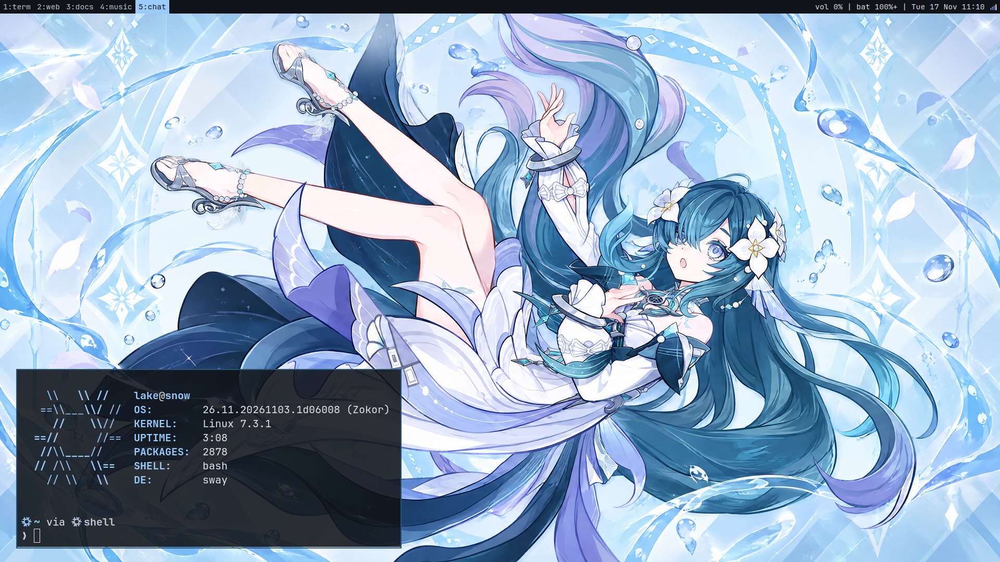

<div align="center">

# ❄️ snow

**Modular, declarative NixOS — one flake, multi host.**




</div>

<br>

## ✦ Overview

Every feature lives in its own module and is auto-imported with
[`import-tree`](https://github.com/vic/import-tree), wired together through
[`flake-parts`](https://github.com/hercules-ci/flake-parts).
Add a file, get a feature. Delete it, it's gone.

## ✦ Stack

|                |                                                                       |
| -------------- | --------------------------------------------------------------------- |
| **Base**       | NixOS unstable · flake-parts · import-tree                            |
| **Home**       | home-manager                                                          |
| **Theming**    | Stylix                                                                |
| **Compositor** | [Mango](https://github.com/mangowm/mango)                             |
| **Shell**      | [DankMaterialShell](https://github.com/AvengeMedia/DankMaterialShell) |
| **Browser**    | Zen Browser                                                           |
| **Editor**     | nixCats (Neovim)                                                      |
| **Extras**     | Spicetify · AAGL                                                      |

## ✦ Structure

```
.
├── flake.nix        # inputs + import-tree entrypoint
├── hosts/
│   └── snow/        # per-machine config & vars
└── modules/         # one file per feature, auto-imported
```

## ✦ Install

```bash
git clone https://github.com/Dityaren/NixOS.git
cd NixOS
```

**1.** Copy `hosts/snow` to `hosts/<your-hostname>`.

**2.** Edit the machine variables:

```nix
flake.vars = {
  username     = "your-username";
  hostname     = "your-hostname";
  stateVersion = "26.05";
  flakeRoot    = "/path/to/this/repo/"; # trailing slash
};
```

**3.** Replace `hardware-configuration.nix` with your own:

```bash
nixos-generate-config --show-hardware-config > hardware-configuration.nix
```

**4.** Rebuild:

```bash
sudo nixos-rebuild switch --flake .#<your-hostname>
```

## ✦ Update

```bash
nix flake update
sudo nixos-rebuild switch --flake .#<your-hostname>
```

<br>

<div align="center">

<sub>MIT licensed · made with ❄️</sub>

</div>
